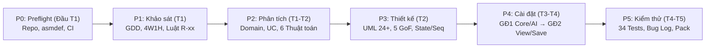

# KẾ HOẠCH TỔNG THỂ DỰ ÁN (MASTER PLAN)
**Dự án:** Crystal Depths – Hầm Ngục Pha Lê (Roguelike Dungeon Top-Down 2D)  
**Phân nhánh đề tài:** 1. Hành động / Platformer / Shooter Real-time (Đề tài số 58)  
**Học phần:** Lập trình hướng đối tượng (MI4090) – K69, Khoa Toán – Tin, ĐHBK Hà Nội  
**Nhóm sinh viên thực hiện:**  
- **TV1:** Nguyễn Đình Huy – MSSV: 202418918 (Phụ trách Lõi Chiến đấu, Vật lý Real-time, AI & Game Loop)  
- **TV2:** Nguyễn Công Huy – MSSV: 202418914 (Phụ trách Thế giới Hầm ngục, Autotile, Vật phẩm, Lưu trữ & UI)  
**Mục tiêu điểm số:** 10.0 / 10.0 (Mức A Xuất sắc) | Mở trần qua 2 Cổng chặn $G_{Product}$ & $G_{Epistemic}$  

---

## 1. TỔNG QUAN & TẦM NHÌN DỰ ÁN

Dự án *"Crystal Depths – Hầm Ngục Pha Lê"* là trò chơi hành động nhập vai hầm ngục (Roguelike Dungeon) thời gian thực góc nhìn từ trên xuống (top-down 2D), được xây dựng trên nền tảng Unity 2D (URP). Điểm cốt lõi của dự án không nằm ở việc làm đồ họa phức tạp, mà là **hiện thực hóa kiến trúc Hướng đối tượng (OOP) mẫu mực**, cô lập hoàn toàn logic nghiệp vụ (Core Domain) khỏi engine hiển thị (Unity), áp dụng chặt chẽ 4 tính chất OOP, nguyên lý SOLID, 5 mẫu thiết kế GoF thực chất và hệ thống kiểm thử tự động Test-Driven Development (TDD).

### Ba nguyên tắc sống còn theo Rubric K69:
1. **Cô lập Game.Core (Pure C#)**: Tuyệt đối không `using UnityEngine` trong các lớp luật chơi, thực thể, thuật toán và mẫu thiết kế. Toàn bộ logic chạy độc lập trong NUnit EditMode Test Runner trong $<2$ giây.
2. **Đối chiếu Hai chiều $A \leftrightarrow B$**: Mỗi quyết định thiết kế trên UML/Đặc tả (A) phải có mã nguồn thật tương ứng (B); mỗi dòng mã nguồn phức tạp phải giải thích được lý do tồn tại từ đặc tả, không có luật ẩn trong đồ họa.
3. **Phân bổ Thực chất TV1 & TV2**: Không chia việc theo kiểu "1 người code – 1 người làm asset/slide". Cả hai thành viên cùng viết Domain, Pattern, Thuật toán, Unit Test và UI, đảm bảo tỷ lệ mã logic 40%–60% rải đều $\ge 3$ tuần trên Git.

---

## 2. CAM KẾT MỤC TIÊU TOÀN DIỆN (TARGET 10 PCU FULL SCOPE)

Nhận định từ Product Owner/Nhóm phát triển: **Không chịu áp lực co hẹp thời gian**, nhóm cam kết triển khai **toàn diện và trọn vẹn 100% Mức 1 (Target Scope)** để đạt chất lượng sản phẩm xuất sắc nhất và tối đa hóa điểm số Trục I & Trục II (10.0/10.0 Mức A):

```
┌────────────────────────────────────────────────────────────────────────┐
│              MỨC 1: TARGET FULL SCOPE (10 PCU - CAM KẾT CHÍNH THỨC)    │
│  - 8 Tầng Campaign theo 4 Biome phong phú (Đá, Nấm, Nước, Dung Nham)   │
│  - 2 Chế độ đặc sắc: Endless Descent (Leo tháp) & Boss Rush (Thách đấu)│
│  - 7 Kiểu AI độc lập, 8 Items, 5 Skills, 5 Phản ứng nguyên tố combo   │
│  - 5 GoF Patterns cốt lõi + 2 Pattern bổ trợ (Command, Flyweight)      │
│  - ≥ 34 Automated Tests + 20 Playtest Matrix + 8 Bugs chuẩn            │
└────────────────────────────────────────────────────────────────────────┘
```

| Mức Scope | Cấu trúc PCU chi tiết | Yêu cầu kỹ thuật thực thi | Đánh giá theo Checklist K69 |
|---|---|---|---|
| **MỨC 1: TARGET (Cam kết chính thức)** | **10 PCU Hoàn chỉnh**: 8 Màn chiến dịch (Hầm Đá Cổ, Hang Nấm Độc, Hầm Ngập Nước, Sảnh Boss Orc, Lò Rèn Dung Nham, Vực Thẳm, Boss Xưởng Golem, Boss cuối Hắc Kỵ Sĩ) + 2 Chế độ (Endless Descent & Boss Rush/Daily Seed). | 10 Use Case, 7 AI, 8 Item, 5 Skill, 5 Phản ứng nguyên tố, $\ge 34$ Test, Command & Flyweight. | **Mức A Tuyệt đối (10.0 / 10.0)**: Thỏa mãn và vượt định mức khắt khe nhất của cả PDF và Checklist. |
| **Mức 2 & 3: Kịch bản dự phòng lý thuyết** | 8 PCU hoặc Sàn cứng 7 PCU (5 tầng + 2 chế độ). | Giữ trong hồ sơ quản trị rủi ro để phục vụ phản biện khi hội đồng hỏi về phương án dự phòng. | **Mức A (Sàn an toàn)**: Chỉ kích hoạt nếu có sự cố bất khả kháng ngoài ý muốn về hạ tầng máy móc. |

### Kịch bản Dự phòng Lý thuyết (Contingency Architecture):
Để đáp ứng yêu cầu của Rubric về "Quản trị rủi ro và phương án ứng phó kỹ thuật", các phương án cắt giảm được lập sẵn trong tài liệu như một minh chứng học thuật về thiết kế module hóa lỏng (Loose Coupling): các tầng hầm ngục và chế độ đều độc lập, có thể bật/tắt qua file `floors.json` mà không ảnh hưởng tới kiến trúc Core.

---

## 3. LỘ TRÌNH 5 TUẦN (TIMELINE T1 – T5) & PHÂN KỲ DỰ ÁN

Lộ trình được ánh xạ 1-1 với 5 bước trong tài liệu chuẩn của TS. Trần Ngọc Thăng:



| Tuần | Giai đoạn (Phase) | Trọng tâm công việc | Đầu ra chính (Deliverables) | Điểm kiểm soát (Quality Gate) |
|:---:|---|---|---|---|
| **T1** | **P0: Preflight** *(Đầu T1)* | Dựng khung repo chuẩn, cấu trúc `Game.Core`, `.gitignore`, CI headless runner, phân chia nhánh Git. | Repo Git, `Game.Core.asmdef`, 1 test xanh rỗng, `evidence_tracker.md`. | Test runner chạy xanh trong $<1$s độc lập. |
| **T1** | **P1: Bước 01 – Khảo sát & Luật** *(T1)* | Mindmap 4W1H, Game Loop kiến trúc 4 bước (60Hz), GDD 2 trang, bảng 20 luật chơi mã hóa `R-01..R-20`. | `01_CONTENT_BIBLE.md`, GDD, Mindmap, 4 Output A–D. | 100% luật chơi có định danh và điều kiện thắng/thua rõ ràng. |
| **T1–T2**| **P2: Bước 02 – Phân tích & AI** *(Cuối T1–T2)*| Cây chức năng, 10 Use Case, Từ điển miền 18 lớp thực chất, giả mã 6 thuật toán, Balancing Table khởi đầu. | Từ điển lớp, phân tích $O(\cdot)$ 6 thuật toán, schema `floors.json`. | 0 lớp rỗng (Anemic model), mỗi thuật toán có lớp chuyên trách. |
| **T2** | **P3: Bước 03 – Thiết kế & Pattern** *(T2)* | 01 UML Class Diagram tổng $\ge 24$ lớp, 5 sơ đồ động, 5 mẫu GoF + bảng vai trò, Wireframe 6 màn hình UI, DTO Save. | PlantUML source, Wireframes, DTO schemas, OCP Drill Kit. | Không có lớp ma, ranh giới Interface TV1 $\leftrightarrow$ TV2 được khóa cứng. |
| **T3–T4**| **P4: Bước 04 – Cài đặt OOP & SOLID** *(T3–T4)* | **GĐ1 (T3)**: Core & AI Headless (M1, M2).<br>**GĐ2 (T4)**: View, Save, Object Pool, Audio, Autotile (M3, M4, M5). | Toàn bộ mã nguồn `src/`, 24 Unit tests, 10 PCU chạy thật, 60 FPS. | Kiểm toán 0 `using UnityEngine` trong Core; Feature Freeze đầu T5. |
| **T4–T5**| **P5: Bước 05 – Kiểm thử & Đóng gói** *(T4–T5)* | 34 automated tests, Mutation Check, Playtest chéo 20 ca, Bug Log 8 lỗi, Build Clean-room $\le 3$p, diễn tập vấn đáp. | Bản build `.exe x64`, Video 3–5p, Slide, Báo cáo PDF hoàn chỉnh. | Clean-room chạy sạch 100% trên máy mới; vượt qua Live OCP/Debug probe. |

---

## 4. MA TRẬN PHÂN CÔNG TRÁCH NHIỆM (RACI MATRIX)

Mô hình phân công theo **lát cắt dọc (Vertical Slicing)**, cả hai thành viên đều đảm nhận đầy đủ 4 trụ cột: **Domain Logic – Design Pattern – Automated Test – Presentation/UI**. Cơ chế phân chia ranh giới module chi tiết và chiến lược lập trình song song không dẫm chân nhau được đặc tả tại [06_MODULE_DECOUPLING_GUIDE.md](file:///d:/project/projectOOPnew/docs/plan/06_MODULE_DECOUPLING_GUIDE.md).

*Phân định vai trò:*
- **TV1 (Nguyễn Đình Huy - 202418918)**: Chủ trì Lõi Chiến đấu, Vật lý Real-time (swept AABB), AI Behaviors, Game Loop 60Hz và Combat HUD.
- **TV2 (Nguyễn Công Huy - 202418914)**: Chủ trì Sinh thế giới (BSP+MST), Autotile blob47, Kho đồ/Loot/Shop, Lưu trữ Save/Load JSON và ScreenManager/Audio.

*Quy ước: **R** (Responsible - Thực hiện chính), **A** (Accountable - Chịu trách nhiệm duyệt & chốt), **C** (Consulted - Đóng góp ý kiến / Viết Mock), **I** (Informed - Được thông báo / Nghe sự kiện).*

| Hạng mục công việc / Gói phân hệ | Thành viên 1 (TV1)<br>Combat & AI Core | Thành viên 2 (TV2)<br>World, Items & Meta | Cơ chế Ràng buộc Hai chiều ($A \leftrightarrow B$) |
|---|:---:|:---:|---|
| **Hợp đồng chung & Cấu trúc Core (P0)** | **A / R** | **R** | Cả hai cùng ký duyệt danh sách Interface/Event chung. |
| **Game Loop, RuleEngine, GameSession (P1)** | **A / R** | **C** | TV1 phát `OnGameTick`, TV2 đăng ký cập nhật trạng thái phòng. |
| **Thuật toán TV1: A* Pathfinding, Collision swept AABB, LOS (P2)**| **A / R** | **C** (Review) | TV2 gọi qua `ITileQuery` để kiểm tra vật cản. |
| **Thuật toán TV2: BSP Dungeon Gen, Autotile blob47, LootRoll (P2)**| **C** (Review) | **A / R** | TV1 lấy dữ liệu phòng từ `Floor` để spawn quái. |
| **Thực thể Actor, Player, Enemy, Boss, Mimic (P2, P4)** | **A / R** | **I** | Kế thừa từ `Actor`, bảo vệ bất biến qua `Health`. |
| **Thực thể Dungeon, Floor, RoomNode, TileGrid, TileKind (P2, P4)**| **I** | **A / R** | Quản lý cấu trúc ô và Flyweight pattern cho Tile. |
| **Hệ thống Kỹ năng (Skill) & Hiệu ứng (StatusEffect) (P2, P4)** | **A / R** | **C** (Loot drop) | Phối hợp phản ứng nguyên tố liên phân hệ. |
| **Hệ thống Vật phẩm (Item), Trang bị, Kho đồ, Ví tiền (P2, P4)** | **C** (Stats buff) | **A / R** | TV2 cấp stats cho Player, TV1 áp dụng vào công thức sát thương. |
| **GoF Pattern: State Pattern & Strategy Pattern (AI)** | **A / R** | **I** | TV1 sở hữu FSM nhân vật và AI ra quyết định. |
| **GoF Pattern: Factory Method (Loot) & Decorator (Enchant)** | **I** | **A / R** | TV2 sở hữu sinh đồ và nâng cấp hiệu ứng vũ khí. |
| **GoF Pattern: Observer Pattern (`GameEventBus`)** | **A / R** (Phát Event) | **A / R** (Lắng nghe) | **Cầu nối trung tâm TV1 $\leftrightarrow$ TV2**, triệt tiêu phụ thuộc vòng. |
| **Lưu trữ trạng thái: Save/Load JSON & HighScore** | **C** (Cung cấp DTO) | **A / R** (Serialize) | DTO chung lưu trọn vẹn cả máu, vị trí lẫn kho đồ, cooldown. |
| **UI & Game Feel: Combat HUD, Floating Text, FX Player** | **A / R** | **I** | TV1 hiển thị thanh máu, mana, nháy trắng, rung camera. |
| **UI & Menus: Title, Pause, Inventory, Shop, GameOver, Audio** | **I** | **A / R** | TV2 dựng các màn hình bằng UI Kit 9-slice và quản lý âm thanh. |
| **Unit Testing & Mocking (P4, P5)** | **R** ($\ge 12$ tests + 2 Mock TV2) | **R** ($\ge 12$ tests + 2 Mock TV1) | TV1 mock `ISaveStorage`, `ITileQuery`; TV2 mock `IDamageable`, `IInput`. |
| **Playtest chéo & Bug Logging (P5)** | **R** (Playtest phần TV2) | **R** (Playtest phần TV1) | Bắt buộc TV1 tìm $\ge 3$ lỗi của TV2 và ngược lại. |
| **Đóng gói Clean-room, Video, Báo cáo (P5)** | **R** (Video Demo, Ch1, Ch2) | **R** (Slide, README, Ch3, Ch4) | Cả hai cùng hoàn thiện Ch5, Ch6 và Phụ lục. |

---

## 5. MA TRẬN TRUY VẾT 20 TIÊU CHÍ CHECKLIST K69

Bảng này ánh xạ toàn bộ 20 tiêu chí đánh giá vào từng Phase cụ thể và chỉ rõ bằng chứng cần kiểm toán trước khi chốt Phase:

```
[Tiêu chí Checklist] ──> [Phase thực hiện] ──> [Đầu ra mã nguồn & Tài liệu] ──> [Cách kiểm chứng tại bàn chấm]
```

| Tiêu chí | Nội dung tóm tắt | Phase chịu trách nhiệm chính | Đầu ra minh chứng cụ thể | Cách kiểm tra tại bàn chấm |
|:---:|---|:---:|---|---|
| **1.1** | $\ge 7$–10 PCU & $\ge 8$ Use Case chia đều | P1, P2, P4 | `floors.json`, 10 UC luồng liên thông | Mở đủ 10 màn/chế độ, chứng minh cơ chế khác nhau |
| **1.2** | Save/Load đồng bộ 2 phân hệ & HighScore | P3, P4, P5 | `SaveManager.cs`, `save_slot_1.json` | Save giữa màn $\rightarrow$ Tắt app $\rightarrow$ Mở lại khôi phục 100% |
| **1.3** | Chiều sâu nội dung & Cân bằng (Balancing) | P2, P4 | Balancing Table, `reactions.json` | Demo combo nguyên tố TV1 $\times$ TV2, chỉnh thông số JSON |
| **1.4** | Đóng gói Clean-room $\le 3$p, Git 40–60% | P0, P5 | Bản build `.exe`, README, Git log | Chạy Clean-room trên máy mới, kiểm tra blame 40-60% |
| **2.1** | Vòng đời trọn vẹn, UI/HUD, Game feel | P3, P4 | `ScreenManager.cs`, 9-slice UI, SFX | Chơi liên hoàn, Replay dọn sạch rác, âm thanh lưu volume |
| **2.2** | Ổn định, chống tunneling, CustomException | P4, P5 | `CollisionDetector.cs`, cây ngoại lệ | Đi sát góc tường, làm hỏng file save không văng app |
| **2.3** | Hiệu năng Real-time, 60 FPS, Object Pool | P4, P5 | `GameLoop.cs`, `ObjectPool<T>.cs` | Stress test 100 đạn không tụt FPS, zero GC spike |
| **2.4** | Clean Code đồng bộ, DRY, 0 dead code | P4, P5 | Solution chuẩn, kiểm toán using | Rà soát toàn bộ code, chỉ 1 hàm chứng minh có thực thi |
| **3.1** | Phân rã Luật R-xx, Game Loop 60Hz ↔ Code | P1, P2 | `RuleEngine.cs`, bảng luật R-01..R-20 | Chỉ 1 nhánh `if` đọc ngược đúng luật gốc (0 đọc comment) |
| **3.2** | Mô hình miền $\ge 13$–16 lớp, chống Anemic | P2, P4 | 18 lớp Entity/VO có hành vi | Giải thích bất biến và lý do tách lớp, cấm model rỗng |
| **3.3** | $\ge 4$ Thuật toán phi tầm thường ($\ge 2$/TV) | P2, P4 | 6 thuật toán: A*, AABB, LOS, BSP, Tile, Loot | Đọc giả mã, nêu $O(\cdot)$, chỉ dòng chặn ca biên cực đoan |
| **4.1** | 01 UML Class tổng $\ge 20$–24 lớp, 6 quan hệ | P3, P4 | PlantUML tổng thể duy nhất | Audit 3 lớp ngẫu nhiên khớp 100% IDE, đúng Composition |
| **4.2** | $\ge 4$ Sơ đồ động khớp Call Stack Debugger | P3, P5 | 3 State Machine + 2 Sequence | Đặt Breakpoint, Call Stack/Watch khớp 100% sơ đồ |
| **4.3** | Kiến trúc 3 tầng, Game.Core không dính Engine| P0, P3, P4 | `Game.Core.asmdef`, 0 UnityEngine | Soi using sạch, chạy Headless Unit Test không mở Scene |
| **4.4** | Đóng gói bất biến, Đa hình, Cross-Module LSP | P4 | `Health.cs`, `CombatResolver.cs` | Truyền Relic TV2 vào Combat TV1 chạy đúng, 0 downcast |
| **4.5** | SOLID cấu trúc (SRP, ISP, DIP), Composition Root | P3, P4 | `GameBootstrap.cs`, interfaces nhỏ | Tráo `InMemoryStorage` tại Root không sửa 1 dòng Core |
| **4.6** | $\ge 3$ GoF Pattern, Live OCP cho cả 2 TV | P3, P4, P5 | 5 mẫu GoF, OCP Drill Kit | Cả 2 TV tự gõ 1 biến thể mới trong 2–3p tắt AI |
| **5.1** | Ma trận truy vết, $\ge 18$–24 Unit Tests AAA | P4, P5 | 24 Unit tests pure logic, Mock chéo | 100% test xanh trong $<2$s không mở Scene |
| **5.2** | $\ge 8$ Integration Tests, Playtest, Bug Log | P5 | 10 Integration tests, Bug Log 8 lỗi | Truy vết Bug-ID $\rightarrow$ Commit $\rightarrow$ Regression Test |
| **5.3** | Live Fault-Injection, IDE Debugger chuyên nghiệp | P5 | 34 automated tests, kịch bản Mutation | Tiêm lỗi biên $\rightarrow$ test FAIL đỏ $\rightarrow$ dùng Debugger sửa xanh |

---

## 6. SỔ RỦI RO DỰ ÁN (RISK REGISTER) & BIỆN PHÁP KIỂM SOÁT 5 BẪY K69

Dưới đây là 5 rủi ro kỹ thuật lớn nhất tương ứng trực tiếp với **5 bẫy bị trừ điểm nặng** được quy định trong Rubric K69:

| Mã Rủi ro | Bẫy trừ điểm K69 | Bản chất sự cố kỹ thuật | Tác động | Biện pháp kỹ thuật phòng ngừa từ gốc |
|:---:|---|---|:---:|---|
| **R-01** | **Bẫy 1: Thổi phồng lớp & Anemic Model** | Tạo hàng loạt lớp rỗng chỉ có `get/set`, không có phương thức nghiệp vụ, không bảo vệ bất biến. | Giới hạn tối đa mức C các mục 3.2, 4.1, 4.4; trần 6.0 điểm. | **Thiết kế từ điển lớp nghiêm ngặt (P2)**: Mỗi lớp Entity bắt buộc phải có ít nhất 1 phương thức thay đổi trạng thái kèm kiểm tra ràng buộc (Validation) hoặc bảo vệ bất biến (VD: `Health.TakeDamage(int amount)` chặn âm và chặn vượt Max). |
| **R-02** | **Bẫy 2: Copy-paste màn chơi / kẻ địch** | Tạo nhiều Scene hoặc class quái chỉ đổi màu sprite và đổi máu tĩnh trong code. | Không được công nhận PCU; rớt xuống $<80\%$ khối lượng $\rightarrow$ Cổng $G_{Product}$ bị khóa trần 6.0 hoặc 3.5. | **Dữ liệu hóa 100% qua JSON (P1, P2)**: Chỉ tạo 1 class `Enemy` nhận `EnemyProfile` từ `enemies.json`. Khác biệt giữa các PCU đến từ cấu trúc ô (`autotile.json`), cơ chế bẫy (`trap_spikes`), hiệu ứng sàn (`lava`, `water`, `pit`) và bộ AI Strategy khác nhau. |
| **R-03** | **Bẫy 3: Gánh team & Rửa commit dồn cuối** | Một thành viên code 80-90% rồi nhờ bạn đẩy commit giả; dồn $>60\%$ commit vào 48h cuối trước hạn. | Hạ hệ số cá nhân xuống 0.50 hoặc 0.00 (F cá nhân); kiểm tra vấn đáp chéo lộ tẩy. | **Phân chia lát cắt dọc, quy ước commit & PR chéo (P0)**: Phân ranh giới rõ ràng: Đình Huy sở hữu nhánh `feat/tv1-*`, Công Huy sở hữu `feat/tv2-*`. Mọi commit bắt buộc tiền tố `[Đình Huy]:` hoặc `[Công Huy]:` (commit chung dùng `[Cả hai]:`). Mọi PR phải do người kia review và merge. Bắt đầu commit ngay từ Tuần 1 với tài liệu và test rỗng để lịch sử trải đều $\ge 3$ tuần. |
| **R-04** | **Bẫy 4: Unit Test hình thức / Tautology** | Viết test cho getter/setter, test không assert, chép công thức code vào expected, test nuốt lỗi `catch {}`. | Trượt Mutation Check; hạ điểm nhóm 5 xuống D/F; nghi ngờ AI sinh test vô thức. | **Áp dụng chuẩn AAA và Mutation Check nội bộ (P4, P5)**: Mỗi test phải tính toán expected độc lập. Cuối mỗi tuần, hai TV tự chạy Mutation Test: cố tình đổi `<= ` thành `<` trong code lõi; nếu test không đỏ thì bắt buộc phải viết lại ca test đó. |
| **R-05** | **Bẫy 5: Dead code & Pattern giả (AI Slop)** | Copy mã từ AI chứa hàng loạt hàm không bao giờ được gọi; dùng tên `Command`, `State` nhưng vẫn viết `if/else` lồng nhau trong Update. | Bị gạch khỏi khối lượng; vấn đáp trượt $G_{Epistemic}$ (trần 3.5 điểm F). | **Comprehension Gate & Kiểm toán Static Analysis (P3, P4)**: Mỗi mẫu GoF phải giải thích được: "Nếu bỏ nó đi thì code smell cụ thể nào xuất hiện?". Trước mỗi lần chốt phase, chạy kiểm tra Call Stack bằng Debugger để chứng minh mọi lớp đều được thực thi thật. |

---

## 7. ĐỊNH NGHĨA HOÀN THÀNH (DEFINITION OF DONE - DOD) TOÀN DỰ ÁN

Một hạng mục công việc chỉ được xem là **Hoàn thành (Done)** khi thỏa mãn đồng thời 6 điều kiện kiểm chứng:
1. **Mã nguồn sạch**: Biên dịch không có cảnh báo nghiêm trọng, tuân thủ đúng quy ước đặt tên C# PascalCase/camelCase, không có khối mã trùng lặp (DRY).
2. **Kiểm toán phụ thuộc**: Không có lệnh `using UnityEngine` trong các lớp thuộc `Game.Core`.
3. **Kiểm thử tự động**: Đi kèm Unit Test tương ứng chuẩn AAA, 100% test trong bộ suite chạy **PASS** độc lập trong Unity Test Runner (EditMode).
4. **Kiểm chứng hai chiều**: Tên lớp, phương thức và thuộc tính khớp 100% với bản vẽ UML và bảng từ điển lớp (không có lớp ma, không sai lệch kiểu).
5. **Đánh giá mã chéo (Peer Review)**: PR được tạo trên Git, được thành viên còn lại review, chạy thử và approve trước khi merge vào nhánh `main`.
6. **Vượt qua Cổng Hiểu (Comprehension Gate)**: Cả hai thành viên đều tự trả lời được câu hỏi truy vết $B \rightarrow A$ và câu hỏi biến động $\Delta$ liên quan đến đoạn mã đó mà không nhìn tài liệu.
